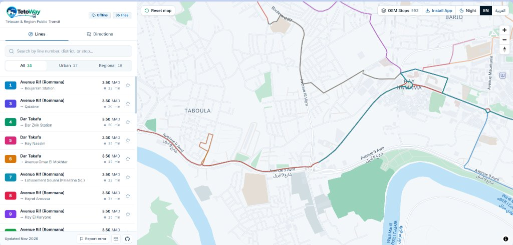
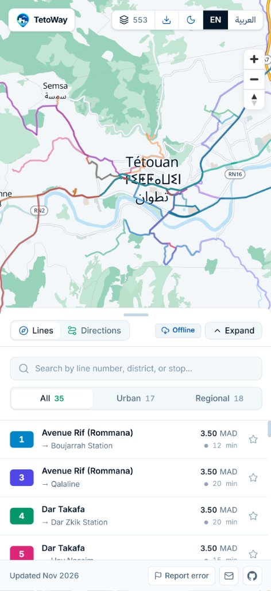
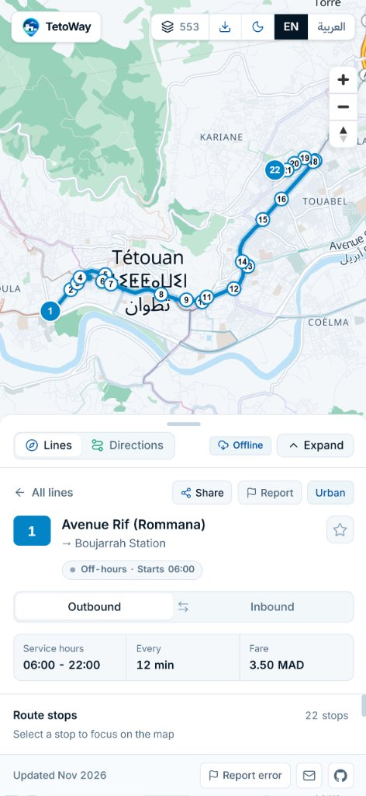
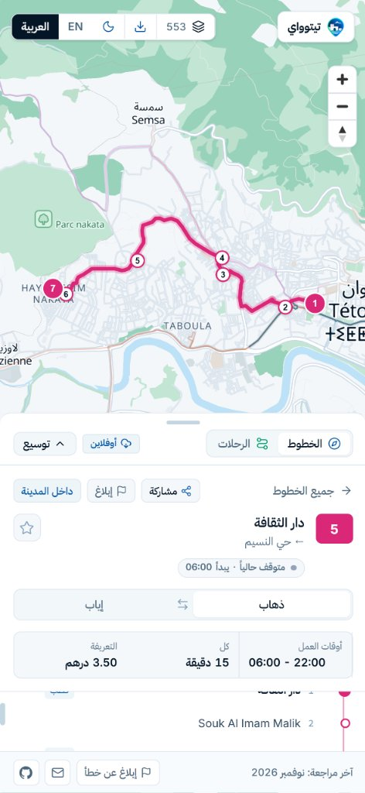
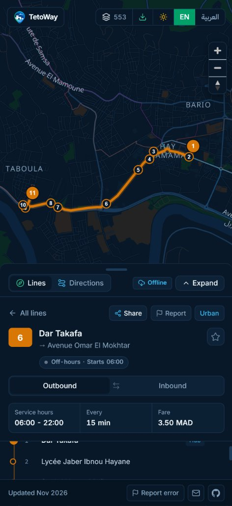

<div align="center">

<picture>
  <source media="(prefers-color-scheme: dark)" srcset="./public/logo-tetoway-dark.png" />
  <source media="(prefers-color-scheme: light)" srcset="./public/logo-tetoway.png" />
  
</picture>

<h3>Interactive Public Transit Map &amp; Trip Planner for Tetouan &amp; Region</h3>
<p><strong>منصة تيتوواي التفاعلية لخريطة ومسارات النقل العمومي بتطوان والنواحي</strong></p>

<p>
  <a href="https://tetoway.vercel.app"><strong>🌐 Live Platform: tetoway.vercel.app</strong></a>
  &nbsp;·&nbsp;
  <a href="#-english"><strong>English Guide</strong></a>
  &nbsp;·&nbsp;
  <a href="#-العربية"><strong>الدليل العربي</strong></a>
</p>

</div>

---

<a id="-english"></a>

## TetoWay — Tetouan Public Transit Platform

**TetoWay** is a modern, 100% static, serverless-friendly interactive GIS public transit web platform covering **Tetouan, Morocco** and its metropolitan and coastal corridors (**Martil, M'diq, Fnideq, Oued Laou, Amsa, Zaouiat Sidi Kacem, Ain Lahcen, Khemis Anjra, Saddina, Dar Ben Karrich, Zinate, and Arbaa Beni Hassan**).

Built with zero paid API keys, it combines OpenStreetMap stop datasets, OSRM street-snapped geometries, client-side spatial routing via Turf.js, and dual Day/Night vector basemaps tailored around the TetoWay brand identity.

> **Live App:** [https://tetoway.vercel.app](https://tetoway.vercel.app)

---

### Screenshots

#### Desktop Experience
<p align="center">
  
</p>

#### Mobile PWA Experience (Day, Night, English & Arabic RTL)
<div align="center">
<table>
  <tr>
    <td align="center" width="25%">
      <strong>Network Explorer</strong><br />
      <sub>35 Lines &amp; Offline Map</sub><br /><br />
      
    </td>
    <td align="center" width="25%">
      <strong>Route &amp; Schedule</strong><br />
      <sub>Share, Report &amp; Live Status</sub><br /><br />
      
    </td>
    <td align="center" width="25%">
      <strong>Arabic RTL</strong><br />
      <sub>Full Mirror &amp; Local Names</sub><br /><br />
      
    </td>
    <td align="center" width="25%">
      <strong>Night Mode</strong><br />
      <sub>Dark Basemap &amp; UI</sub><br /><br />
      
    </td>
  </tr>
</table>
</div>

---

### Core Features

- **35 Real Road-Snapped Bus Lines (17 Urban + 18 Regional):**
  Every corridor passes through verified Tetouan terminals and intermediate waypoints (`scripts/generate-transit-data.mjs`) snapped smoothly along actual streets using OSRM (`LineString` GeoJSON) rather than straight lines.
- **553 OpenStreetMap Bus Stops Layer:**
  Toggleable live OSM stops overlay (`public/data/osm-stops.json`) fetched from Overpass API with interactive click popups showing connecting bus lines within walking range.
- **Day & Night Modes Harmonized with TetoWay Branding:**
  - **Day Mode (Default):** Clean whitewashed Medina surfaces (`#FFFFFF` / `#F2F7FA`), deep navy typography (`#041626`), marine blue (`#0155A6`) and Rif emerald (`#01A069`) accents over **CartoDB Voyager** vector maps.
  - **Night Mode:** Deep Mediterranean marine navy UI (`#081828` / `#05101C`), coastal cyan (`#22D3EE`) & emerald (`#34D399`) accents, and a dedicated transparent night wordmark over **CartoDB Dark Matter** vector tiles.
- **Strict Bilingual EN (`LTR`) & AR (`RTL`) Experience:**
  Instant switching between English and Arabic UI with isolated `dir="ltr"` / `dir="rtl"` containers and standard Western numerals (`0-9`) for all route shields, schedules, fares, and walking metrics.
- **Smart Trip Planner & Nearest Stop Finder:**
  - **Locate Me / Pick on Map:** Finds the closest served bus stop with walking distance, estimated walk duration, dashed walking connector on the map, and serving lines.
  - **Origin (A) to Destination (B):** Computes optimal direct and 1-transfer hub itineraries via Turf.js spatial analysis, complete with boarding/alighting stops, stop counts, transfer hub cues, and total MAD fare.
- **Built-in Route Studio (GIS Editor):**
  Select any line, drag stop markers directly on the map, click the map to insert stops along the corridor, edit bilingual English/Arabic stop names, reorder/remove stops, re-snap street geometries live via OSRM, and export updated JSON (`tetouan-lines.json`).
- **Mobile-First Transit Sheet:**
  Full-screen interactive map on mobile (`< 768px`) paired with a 3-state collapsible Bottom Sheet drawer (`collapsed`, `half`, `expanded`).

---

### Bus Network Directory (35 Lines)

#### Urban Network (17 Lines — `3.50 MAD`)

| Line | Route (Origin ↔ Destination) | Frequency |
| :---: | :--- | :---: |
| **1** | Avenue Rif (Rommana) ↔ Boujarrah Station | 12 min |
| **3** | Avenue Rif (Rommana) ↔ Qalaline | 20 min |
| **4** | Dar Takafa ↔ Dar Zkik Station | 20 min |
| **5** | Dar Takafa ↔ Hay Nassim | 15 min |
| **6** | Dar Takafa ↔ Avenue Omar El Mokhtar | 15 min |
| **7** | Avenue Rif (Rommana) ↔ Lotissement Souani (Palestine Sq.) | 12 min |
| **8** | Avenue Rif (Rommana) ↔ Hajrat Aroussa | 15 min |
| **9** | Avenue Rif (Rommana) ↔ Hay El Karyane | 15 min |
| **10** | Avenue Rif (Rommana) ↔ Avenue Mokhtar Soussi | 15 min |
| **11** | Dar Takafa ↔ Ain Samsa | 20 min |
| **12** | Old Railway Station ↔ Avenue Zaio (Jamaa Mezouak) | 12 min |
| **13** | Avenue Rif (Rommana) ↔ Bouanane | 25 min |
| **14** | Dar Takafa ↔ Av. Abderrahmane Dakhil | 15 min |
| **15** | University District ↔ Torreta (El Borj) | 12 min |
| **16** | Avenue Rif (Rommana) ↔ National Route 13 (Malaliyine) | 20 min |
| **17** | Avenue Rif (Rommana) ↔ Avenue Abdellah El Fakhar | 20 min |
| **18** | Avenue Rif (Rommana) ↔ Hay Barbourine | 20 min |

#### Regional & Suburban Network (18 Lines — `4.00` to `8.00 MAD`)

| Line | Route (Origin ↔ Destination) | Fare | Frequency |
| :---: | :--- | :---: | :---: |
| **19** | Avenue Rif (Rommana) ↔ Amsa | 4.50 MAD | 35 min |
| **20** | Avenue Rif (Rommana) ↔ Azla | 4.50 MAD | 30 min |
| **21** | Old Railway Station ↔ Oued Laou (Souk Beni Said) | 8.00 MAD | 40 min |
| **22** | Avenue Khalid Ibn Walid ↔ Sahtriyine | 4.00 MAD | 20 min |
| **23** | Dar Takafa ↔ Ain Lahcen | 5.00 MAD | 30 min |
| **24** | Dar Takafa ↔ Khemis Anjra | 6.00 MAD | 40 min |
| **25** | Dar Takafa ↔ Saddina | 5.00 MAD | 35 min |
| **26** | Avenue Rif (Rommana) ↔ Malaliyine | 4.00 MAD | 20 min |
| **27** | Old Railway Station ↔ Dar Ben Karrich | 4.50 MAD | 25 min |
| **28** | Old Railway Station ↔ Zinate | 5.50 MAD | 40 min |
| **29** | Old Railway Station ↔ Arbaa Beni Hassan | 7.00 MAD | 45 min |
| **30** | Old Railway Station ↔ Beni Salah | 4.00 MAD | 30 min |
| **31** | Old Railway Station ↔ Ain Zarka | 4.50 MAD | 35 min |
| **32** | Hay Bouzaghlal ↔ Martil | 4.50 MAD | 25 min |
| **33** | Fnideq ↔ Martil | 6.00 MAD | 25 min |
| **34** | Avenue Rif (Rommana) ↔ M'diq | 5.00 MAD | 15 min |
| **35** | Avenue Rif (Rommana) ↔ Fnideq | 7.00 MAD | 15 min |
| **36** | Avenue Rif (Rommana) ↔ Martil | 4.00 MAD | 10 min |

---

### Architecture & Project Structure

```text
├── public/
│   ├── data/
│   │   ├── osm-stops.json         # 553 normalized OpenStreetMap bus stops
│   │   └── tetouan-lines.json     # 35 OSRM road-snapped lines & ordered stops
│   ├── favicon.png                # Browser tab icon
│   ├── logo-pin.png               # Tetouan Medina & Rif pin emblem
│   ├── logo-tetoway.png           # Full TetoWay lockup (Light Mode)
│   └── logo-tetoway-dark.png      # Full TetoWay lockup (Dark Mode)
├── scripts/
│   └── generate-transit-data.mjs  # Overpass + OSRM automated GIS pipeline
├── src/
│   ├── components/
│   │   ├── BidiText.tsx           # BiDi isolation wrapper & contrast-aware line shields
│   │   ├── LineExplorer.tsx       # Bilingual search, Urban/Regional tabs & stop timeline
│   │   ├── MobileBottomSheet.tsx  # Collapsible mobile bottom drawer
│   │   ├── RouteEditor.tsx        # Studio editor for stops & live OSRM re-snapping
│   │   ├── TopBar.tsx             # Unified docked toolbar (OSM, Editor, Day/Night, EN/AR)
│   │   ├── TransitMap.tsx         # MapLibre GL map, style rehydration & interactive markers
│   │   └── TripPlanner.tsx        # Nearest stop finder & A-to-B itinerary computation
│   ├── i18n/
│   │   ├── ar.json                # Arabic strings & terminal labels
│   │   ├── en.json                # English strings & terminal labels
│   │   └── index.ts               # Translation & BiDi label helpers
│   ├── types/transit.ts           # TypeScript domain definitions
│   ├── utils/transitGeo.ts        # Turf.js spatial search, routing, and OSRM client
│   ├── App.tsx                    # Root shell, responsive layout & state orchestration
│   └── index.css                  # Tailwind v4 + TetoWay theme tokens & MapLibre overrides
└── vercel.json                    # Zero-config static Vercel deployment preset
```

---

### Tech Stack & Local Setup

- **Frontend:** React 19, TypeScript, Vite 8, Tailwind CSS v4
- **Mapping & Spatial GIS:** MapLibre GL JS 6, Turf.js (`@turf/turf`), Lucide Icons
- **Quality & Linting:** `oxlint` + `tsc -b`

```bash
# Install dependencies
npm install

# Regenerate GIS datasets from Overpass + OSRM (optional, cached in public/data/)
npm run generate:data

# Start local development server
npm run dev

# Lint and production build
npm run lint
npm run build
```

---

<a id="-العربية"></a>

<div dir="rtl">

## تيتوواي — منصة النقل العمومي بتطوان والنواحي

**تيتوواي (TetoWay)** هي منصة خرائط تفاعلية مجانية وسريعة للنقل الحضري وشبه الحضري في **تطوان والنواحي** (مارتيل، المضيق، الفنيدق، واد لو، امسا، زاوية سيدي قاسم، عين الحصن، خميس أنجرة، صدينة، دار بن قريش، الزينات، وأربعاء بني حسان).

تعمل المنصة بشكل ثابت بالكامل دون أي مفاتيح API مدفوعة، وتعتمد على خرائط **MapLibre GL** وتحليلات مكانية فورية عبر **Turf.js** مع بيانات محطات **OpenStreetMap** ومسارات حقيقية مسحوبة على الطرقات عبر **OSRM**، بتصميم مستلهم بالكامل من ألوان شعار تطوان في الوضعين النهاري والليلي.

> **رابط المنصة المباشر:** [https://tetoway.vercel.app](https://tetoway.vercel.app)

---

### لقطات من المنصة (نسخة الحاسوب والهاتف)

#### نسخة الحاسوب
<p align="center">
  
</p>

#### نسخة الهاتف (الوضع النهاري والليلي — العربية والإنجليزية)
<div align="center" dir="rtl">
<table>
  <tr>
    <td align="center" width="25%">
      <strong>خريطة الشبكة</strong><br />
      <sub>35 خطاً وعرض أوفلاين</sub><br /><br />
      
    </td>
    <td align="center" width="25%">
      <strong>تفاصيل المسار</strong><br />
      <sub>مشاركة، إبلاغ، وحالة الخدمة</sub><br /><br />
      
    </td>
    <td align="center" width="25%">
      <strong>الواجهة العربية RTL</strong><br />
      <sub>تجاوب كامل من اليمين لليسار</sub><br /><br />
      
    </td>
    <td align="center" width="25%">
      <strong>الوضع الليلي</strong><br />
      <sub>خريطة وواجهة داكنة</sub><br /><br />
      
    </td>
  </tr>
</table>
</div>

---

### أبرز المميزات

- **35 خط حافلات بمسارات حقيقية على الطرقات (17 خطاً حضرياً + 18 خطاً جهوياً):**
  تم ربط جميع الأقطاب والمحطات الوسيطية في تطوان بدقة وسحب المسارات آلياً عبر خدمة OSRM لتتبع الشوارع الفعلية دون خطوط مستقيمة عشوائية.
- **طبقة محطات الخريطة المفتوحة (553 محطة OSM):**
  إمكانية إظهار وإخفاء محطات OpenStreetMap فوق الخريطة مع نوافذ منبثقة تعرض أقرب خطوط الحافلات التي تمر بكل محطة.
- **الوضع النهاري والوضع الليلي بألوان شعار تيتوواي:**
  - **الوضع النهاري:** واجهة ناصعة مستوحاة من بياض تطوان والأزرق البحري والأخضر الريفي فوق خرائط CartoDB Voyager الفاتحة.
  - **الوضع الليلي:** واجهة بكحلي ليلي بحري أنيق (`#081828` / `#05101C`) ولمسات سماوية وزمردية مريحة للعين مع نسخة مخصصة شفافة من الشعار فوق خرائط CartoDB Dark Matter.
- **دعم ثنائي اللغة (العربية `RTL` والإنجليزية `LTR`):**
  فصل دقيق لاتجاه النصوص والواجهات مع اعتماد الأرقام القياسية (`0-9`) لسهولة قراءة أرقام الخطوط والتعريفات والأوقات.
- **مخطط الرحلات وأقرب محطة إليك:**
  - **تحديد الموقع أو اختيار نقطة على الخريطة:** حساب أقرب محطة حافلات متاحة مع مسافة ومدة المشي ورسم مسار المشي على الخريطة.
  - **التوجيه من النقطة A إلى النقطة B:** اقتراح الرحلات المباشرة والرحلات ذات تبديل واحد عند الأقطاب الرئيسية مع تفاصيل الركوب والنزول والتعريفة الإجمالية بالدرهم.
- **استوديو تعديل المسارات (Route Studio):**
  إتاحة سحب دبابيس المحطات على الخريطة، إضافة محطات جديدة أو إعادة ترتيبها، تعديل الأسماء بالعربية والإنجليزية، إعادة محاذاة المسار حياً على الطرقات عبر OSRM، وتصدير ملف `tetouan-lines.json`.
- **تجربة مثالية للهاتف المحمول:**
  خريطة بملء الشاشة على الهواتف مع لوح سفلي قابل للسحب والتوسيع والتصغير (`Bottom Sheet`).

---

### دليل شبكة الخطوط (35 خطاً)

#### الخطوط داخل المدينة (17 خطاً — `3.50 درهم`)

| رقم الخط | المسار (نقطة الانطلاق ⬌ نقطة الوصول) | التواتر |
| :---: | :--- | :---: |
| **1** | شارع الريف (الرمانة) ⬌ محطة بوجراح | كل 12 دقيقة |
| **3** | شارع الريف (الرمانة) ⬌ القلالين | كل 20 دقيقة |
| **4** | دار الثقافة ⬌ محطة دار الزكيك | كل 20 دقيقة |
| **5** | دار الثقافة ⬌ حي النسيم | كل 15 دقيقة |
| **6** | دار الثقافة ⬌ شارع عمر المختار | كل 15 دقيقة |
| **7** | شارع الريف (الرمانة) ⬌ تجزئة الصواني (ساحة فلسطين) | كل 12 دقيقة |
| **8** | شارع الريف (الرمانة) ⬌ حجر العروسة | كل 15 دقيقة |
| **9** | شارع الريف (الرمانة) ⬌ حي الكاريان | كل 15 دقيقة |
| **10** | شارع الريف (الرمانة) ⬌ شارع مختار السوسي | كل 15 دقيقة |
| **11** | دار الثقافة ⬌ عين صمصة | كل 20 دقيقة |
| **12** | محطة السكك الحديدية القديمة ⬌ شارع زايو (حي جامع مزواق) | كل 12 دقيقة |
| **13** | شارع الريف (الرمانة) ⬌ بوعنان | كل 25 دقيقة |
| **14** | دار الثقافة ⬌ شارع عبد الرحمان الداخل | كل 15 دقيقة |
| **15** | الحي الجامعي ⬌ طوريطا (البرج) | كل 12 دقيقة |
| **16** | شارع الريف (الرمانة) ⬌ الطريق الوطنية 13 (الملاليين) | كل 20 دقيقة |
| **17** | شارع الريف (الرمانة) ⬌ شارع عبد الله الفخار | كل 20 دقيقة |
| **18** | شارع الريف (الرمانة) ⬌ حي الباربورين | كل 20 دقيقة |

#### الخطوط الرابطة بين تطوان والنواحي (18 خطاً — `4.00` إلى `8.00 درهم`)

| رقم الخط | المسار (نقطة الانطلاق ⬌ نقطة الوصول) | التعريفة | التواتر |
| :---: | :--- | :---: | :---: |
| **19** | شارع الريف (الرمانة) ⬌ أمسا | 4.50 درهم | كل 35 دقيقة |
| **20** | شارع الريف (الرمانة) ⬌ أزلا | 4.50 درهم | كل 30 دقيقة |
| **21** | محطة السكك الحديدية القديمة ⬌ واد لاو (سوق بني سعيد) | 8.00 درهم | كل 40 دقيقة |
| **22** | شارع خالد بن الوليد ⬌ السحتريين | 4.00 درهم | كل 20 دقيقة |
| **23** | دار الثقافة ⬌ عين الحصن | 5.00 درهم | كل 30 دقيقة |
| **24** | دار الثقافة ⬌ خميس أنجرة | 6.00 درهم | كل 40 دقيقة |
| **25** | دار الثقافة ⬌ صدينة | 5.00 درهم | كل 35 دقيقة |
| **26** | شارع الريف (الرمانة) ⬌ الملاليين | 4.00 درهم | كل 20 دقيقة |
| **27** | محطة السكك الحديدية القديمة ⬌ دار بن قريش | 4.50 درهم | كل 25 دقيقة |
| **28** | محطة السكك الحديدية القديمة ⬌ الزينات | 5.50 درهم | كل 40 دقيقة |
| **29** | محطة السكك الحديدية القديمة ⬌ أربعاء بني حسان | 7.00 درهم | كل 45 دقيقة |
| **30** | محطة السكك الحديدية القديمة ⬌ بني صالح | 4.00 درهم | كل 30 دقيقة |
| **31** | محطة السكك الحديدية القديمة ⬌ العين الزرقاء | 4.50 درهم | كل 35 دقيقة |
| **32** | حي بوزغلال ⬌ مرتيل | 4.50 درهم | كل 25 دقيقة |
| **33** | الفنيدق ⬌ مرتيل | 6.00 درهم | كل 25 دقيقة |
| **34** | شارع الريف (الرمانة) ⬌ المضيق | 5.00 درهم | كل 15 دقيقة |
| **35** | شارع الريف (الرمانة) ⬌ الفنيدق | 7.00 درهم | كل 15 دقيقة |
| **36** | شارع الريف (الرمانة) ⬌ مرتيل | 4.00 درهم | كل 10 دقائق |

---

### التشغيل والتطوير المحلي

<div dir="ltr">

```bash
npm install
npm run generate:data
npm run dev
npm run lint
npm run build
```

</div>

تم إعداد المشروع للنشر المباشر على **Vercel** عبر [`vercel.json`](./vercel.json) دون الحاجة لأي خادم خلفي أو متغيرات بيئة سرية.

</div>
